# Taskbear Web Application – Response Manipulation Findings

## Overview

During authorized security testing of the Taskbear web application, response manipulation was observed in multiple verification and registration flows using Burp Suite.

The following three instances are documented:

1. **Mobile OTP Verification – Response Manipulation**
2. **Email OTP Verification – Response Manipulation**
3. **Signup Flow – Response Manipulation**

> **Important:** Changing an HTTP response from `401` to `200` does not by itself prove that the backend accepted the operation. The strongest evidence is whether the application subsequently grants access or advances to a security-sensitive state.

---

# 1. Mobile OTP Verification – Response Manipulation

## Vulnerability Type

**OTP Verification – Response Manipulation / Client-Side Trust Issue**

## Target Application

**Taskbear Web Application**

## Vulnerable Endpoint

```http
POST /api/v1/uwa/auth/otp/verify
```

## Description

During testing of the mobile OTP verification process, an invalid OTP was submitted.

The original server response rejected the OTP with:

```http
HTTP/2 401 Unauthorized
```

with the message:

```json
{
  "statusCode": 401,
  "message": "OTP invalid or expired"
}
```

The response was then manipulated in Burp Suite to return a successful response:

```http
HTTP/2 200 OK
```

with:

```json
{
  "statusCode": 200,
  "message": "OTP verified successfully"
}
```

The application subsequently continued the verification flow.

## Steps to Reproduce

### Step 1 – Open mobile verification

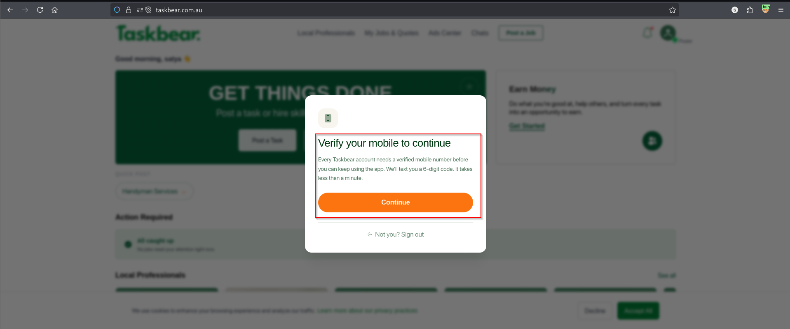

### Step 2 – Confirm the mobile number

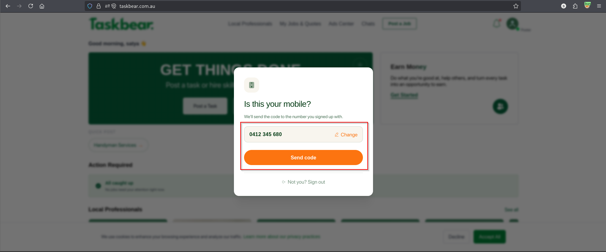

### Step 3 – Submit an invalid OTP

An invalid OTP such as `123456` was submitted.

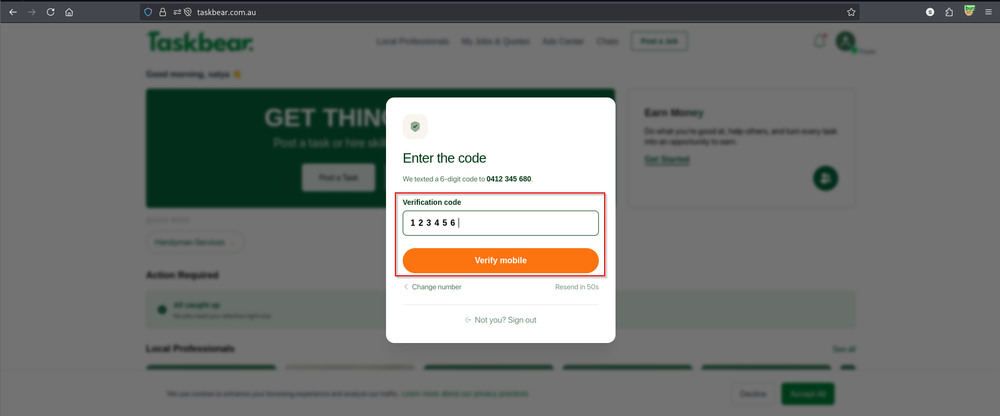

### Step 4 – Observe the original server response

The server rejected the invalid OTP with `401 Unauthorized`.

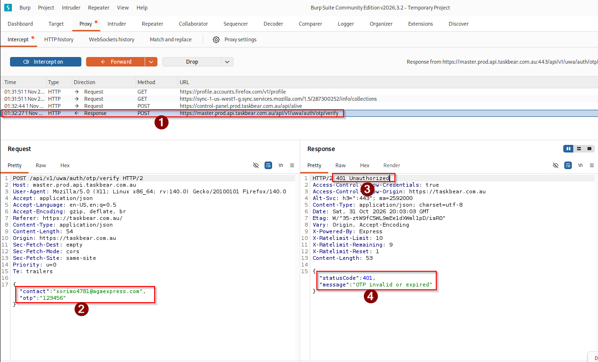

### Step 5 – Manipulate the response

The response was modified in Burp Suite to indicate successful verification.

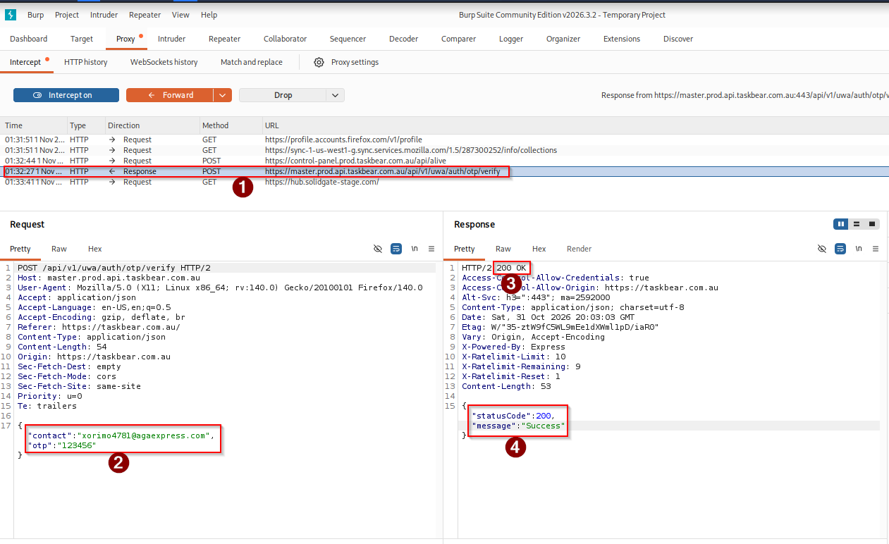

### Step 6 – Verify the resulting application state

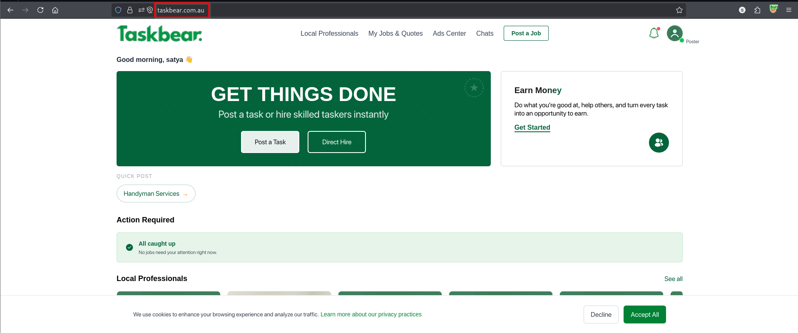

## Impact

If the application relies on client-controlled response data for verification decisions, an attacker may potentially bypass the intended OTP verification control.

Potential impact includes:

- Bypass of mobile OTP verification
- Unauthorized continuation of protected workflows
- Weakening of account verification controls
- Possible account compromise depending on how subsequent server-side authorization is implemented

## Remediation

- Perform OTP validation exclusively on the server side.
- Do not trust HTTP status codes or success messages supplied through client-side response handling.
- Maintain OTP verification state server-side.
- Ensure subsequent sensitive endpoints independently verify the user's verification state.
- Use short-lived, single-use OTPs.
- Enforce OTP attempt limits and rate limiting.

---

# 2. Email OTP Verification – Response Manipulation

## Vulnerability Type

**OTP Verification – Response Manipulation / Client-Side Trust Issue**

## Target Application

**Taskbear Web Application**

## Vulnerable Endpoint

```http
POST /api/v1/uwa/auth/otp/verify
```

## Description

During testing of the email OTP verification process, an invalid OTP was submitted.

The original response was:

```http
HTTP/2 401 Unauthorized
```

with:

```json
{
  "statusCode": 401,
  "message": "OTP invalid or expired"
}
```

The response was manipulated using Burp Suite to return a successful verification response:

```http
HTTP/2 200 OK
```

The application subsequently proceeded with the registration flow.

## Steps to Reproduce

### Step 1 – Start the registration process


### Step 2 – Retrieve the email verification code

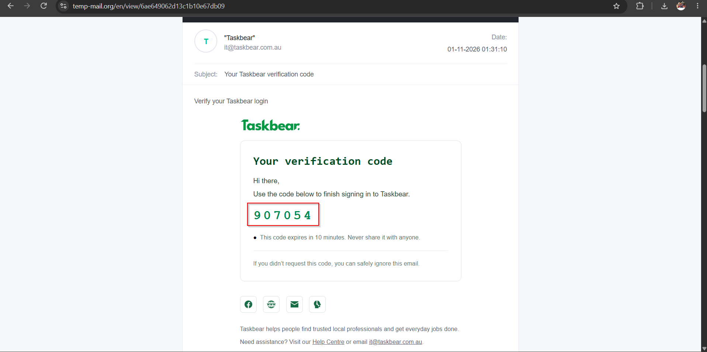

### Step 3 – Submit an invalid OTP

An invalid OTP was submitted instead of the valid verification code.


### Step 4 – Observe the original response

The server returned:

```http
HTTP/2 401 Unauthorized
```

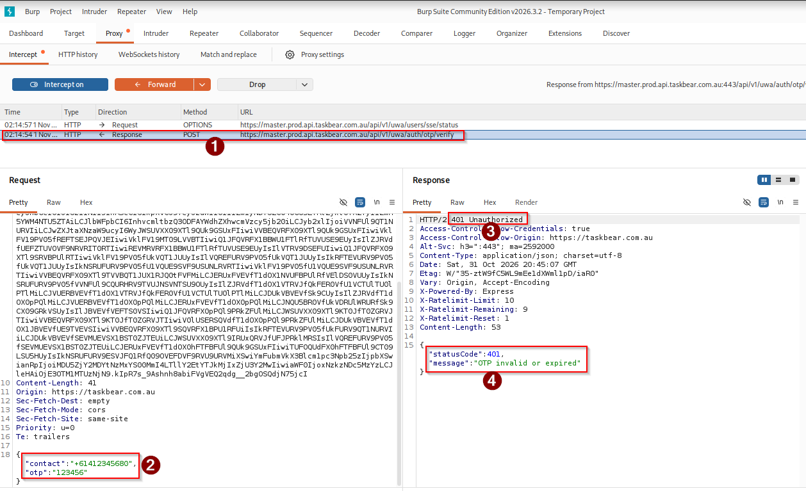

### Step 5 – Manipulate the response

The response was modified to indicate successful verification.

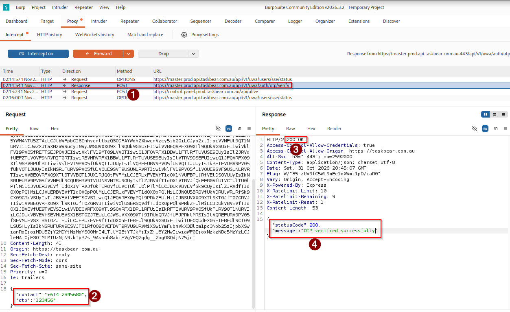

### Step 6 – Verify registration flow continuation

The application proceeded to the next registration step.

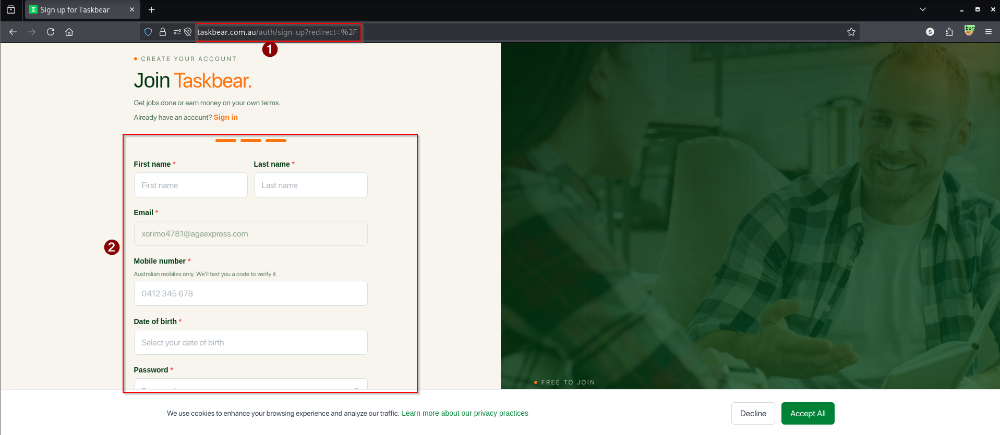

## Impact

If the subsequent registration process does not independently verify the email verification state on the server, an attacker may potentially register an account without successfully completing email OTP verification.

Potential impact includes:

- Bypass of email verification
- Unauthorized account registration
- Weakening of account validation controls
- Potential abuse of email-based trust mechanisms

## Remediation

- Validate email OTPs server-side.
- Store verification state server-side and bind it to the registration session.
- Do not rely on client-side interpretation of `200 OK` or success messages.
- Ensure the final account-creation endpoint independently verifies the email verification state.
- Implement OTP expiration, single-use enforcement, rate limiting, and attempt limits.

---

# 3. Signup Flow – Response Manipulation

## Vulnerability Type

**Signup Response Manipulation / Client-Side Trust Issue**

## Target Application

**Taskbear Web Application**

## Vulnerable Endpoint

```http
POST /api/v1/uwa/auth/signup
```

## Description

During testing of the signup functionality, a registration request using an already-associated mobile number was submitted.

The server correctly rejected the request with:

```http
HTTP/2 401 Unauthorized
```

and returned:

```json
{
  "statusCode": 401,
  "message": "Account already exists under this mobile number"
}
```

The HTTP response status was then manipulated in Burp Suite from `401 Unauthorized` to `200 OK`.

The application subsequently redirected to the sign-in page.

> **Note:** The screenshots demonstrate response manipulation and application-flow continuation. They should not be described as a fully confirmed account-creation bypass unless a new account was actually created or another protected state was reached as a direct result of the manipulated response.

## Steps to Reproduce

### Step 1 – Submit the signup form

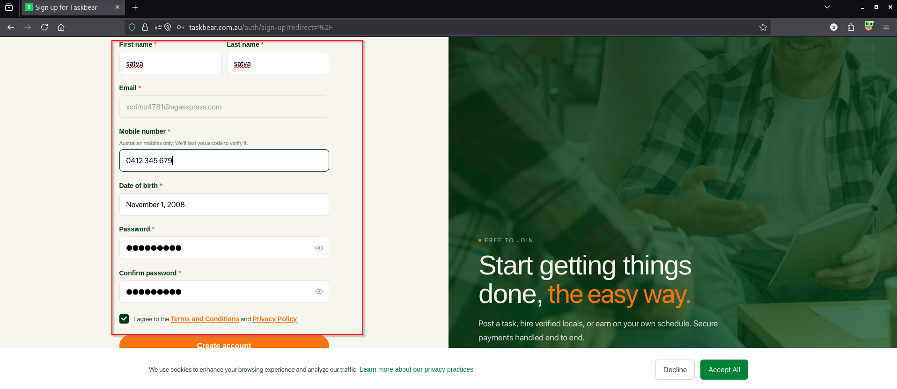

### Step 2 – Observe the original rejection

The server returned:

```http
HTTP/2 401 Unauthorized
```

with:

```json
{
  "statusCode": 401,
  "message": "Account already exists under this mobile number"
}
```

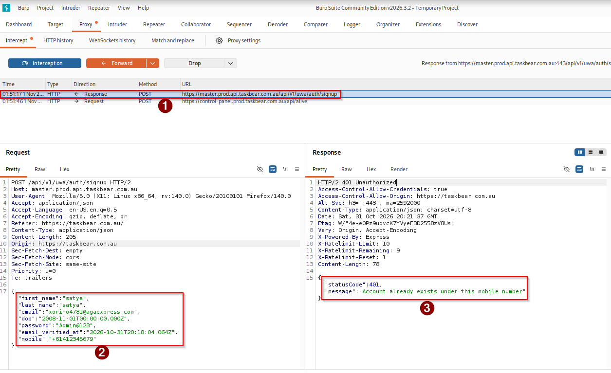

### Step 3 – Manipulate the HTTP response

The HTTP status was changed from:

```http
401 Unauthorized
```

to:

```http
200 OK
```

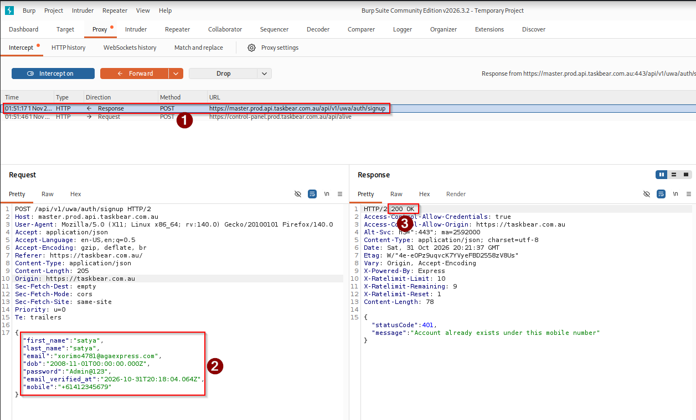

### Step 4 – Observe the resulting application flow

The application redirected to the sign-in page.

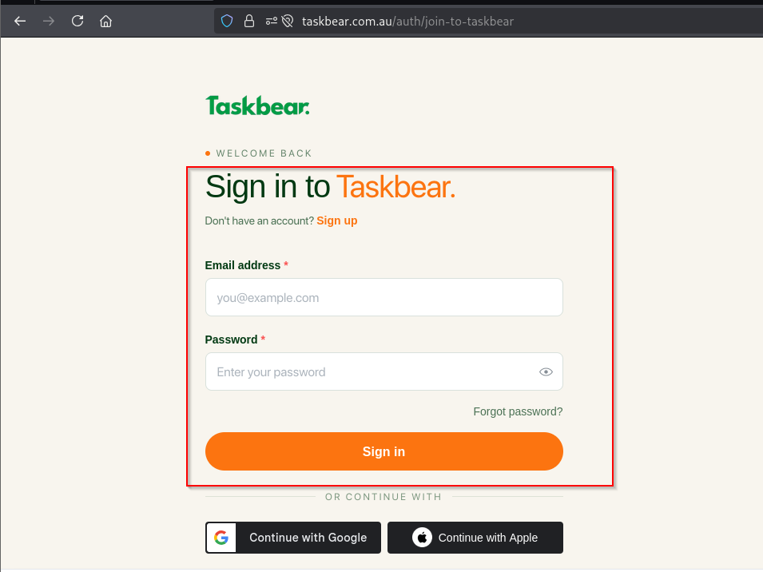

## Impact

If security-sensitive signup decisions depend on client-side interpretation of the HTTP response, response manipulation may allow an attacker to bypass intended registration restrictions.

Potential impact depends on backend enforcement and may include:

- Bypass of client-side signup restrictions
- Unauthorized continuation of registration workflows
- Inconsistent application state
- Potential account duplication or registration abuse if backend validation is insufficient

## Remediation

- Enforce all signup restrictions server-side.
- Do not trust client-side response status or messages.
- Ensure the final account-creation endpoint independently validates account uniqueness.
- Return and enforce a server-side registration state.
- Ensure a manipulated response cannot result in account creation without successful backend validation.

---

# Evidence Summary

| Instance | Original Response | Manipulated Response | Result |
|---|---|---|---|
| Mobile OTP | `401 Unauthorized` | `200 OK` | Verification flow continued |
| Email OTP | `401 Unauthorized` | `200 OK` | Registration flow continued |
| Signup | `401 Unauthorized` | `200 OK` | Application redirected to sign-in |

# Security Recommendation

The application should treat OTP verification, account uniqueness, and registration state as **server-side security decisions**.

Client-side applications must never be able to establish a trusted verification or registration state merely by receiving or interpreting a modified HTTP response.

## Tools Used

- Burp Suite
- Web Browser
- HTTP Proxy / Intercept
- Taskbear Web Application

## Learning Outcome

These tests demonstrate how Burp Suite can be used to identify cases where application logic may rely on client-side interpretation of server responses, and why response manipulation alone must be distinguished from a genuine server-side security bypass.
